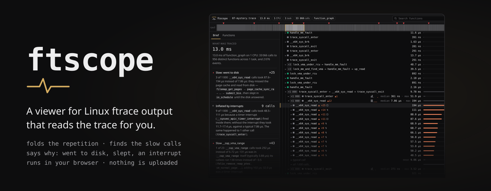
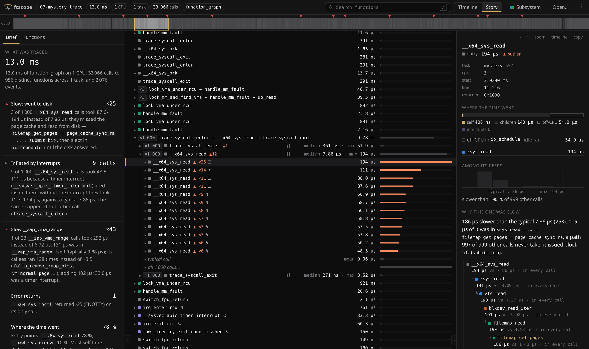

<p align="center"></p>

# ftscope

Viewer for Linux ftrace output. Folds repeated calls into one row, finds the
calls that are slow compared with other calls of the same function, and shows
where their time went.

<https://zahakj.github.io/ftscope/>



## Usage

Record a trace (root):

```sh
git clone https://github.com/ZahakJ/ftscope
cd ftscope
sudo ./tools/ftscope-record -- ls -l /usr/bin
```

Open the site and drop `ftrace.trace` on it. `ftscope-record -h` lists its
options; it restores the tracing settings it changed.

Offline: save <https://zahakj.github.io/ftscope/ftscope.html> and open it from
disk.

Input is text from `/sys/kernel/tracing/trace`, `trace_pipe` or
`trace-cmd report`, plain or gzipped. For binary `trace.dat`, run
`trace-cmd report > file` first.

By hand:

```sh
cd /sys/kernel/tracing
echo function_graph > current_tracer
echo funcgraph-abstime > trace_options
echo funcgraph-proc > trace_options
echo 1 > events/sched/sched_switch/enable
echo 1 > tracing_on; your-command; echo 0 > tracing_on
cat trace > ~/my.trace
echo nop > current_tracer
```

Without `funcgraph-abstime` there are no timestamps; time is laid out from the
printed durations. Without `sched_switch`, time asleep counts as work.

## Views

| | |
| --- | --- |
| Brief | findings, most important first |
| Functions | per-function calls, self, total, typical, max |
| Timeline | one lane per task, calls nested downward |
| Story | folded call tree, in order |
| Inspector | selected call: time split, peers, why slow, raw lines |

The URL holds the selection and view.

## Keys

| key | |
| --- | --- |
| `/` | search; Enter / Shift+Enter step through matches |
| `1` `2` | timeline, story |
| `w` `s` | zoom in, out |
| `a` `d` | pan |
| `f` | fit selection |
| `0` | fit all |
| `[` `]` | previous, next call of the same function |
| `o` | next outlier |
| `c` | colour by subsystem or by surprise |
| `,` `.` | toggle left, right panel |
| `Esc` | clear search, then selection |
| `?` | help |

## Build

```sh
npm install
npm run dev            # http://127.0.0.1:5990
npm test
npm run build          # dist/
npm run build:single   # dist-single/ftscope.html
npx vite-node scripts/brief.ts some.trace
```

## Example traces

`examples/traces/` are captures from Linux 7.1.8, made by `lab/` in a KVM
guest (needs Docker and `/dev/kvm`):

```sh
./lab/run.sh
```

See `examples/traces/README.md`. How ftrace works:
[docs/ftrace.md](docs/ftrace.md).

## License

MIT
